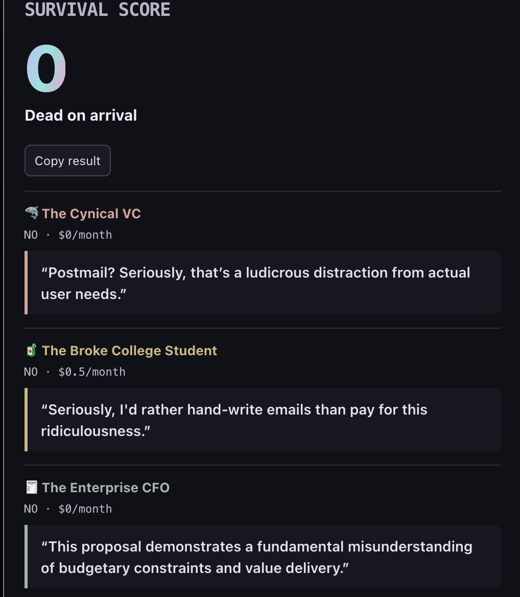

# Persona Fight Club

Paste a product idea. Ten AI personas react to it in a live group chat, and each one leaves a fix. Five of them then vote on whether they would pay for it, and a Survival Score is calculated from those votes.

Everything runs on your own machine. No API keys, no accounts, no backend, and nothing you type is sent anywhere. The AI is a small open model served locally by [Ollama](https://ollama.com).



## Features

- Ten personas: The Cynical VC, The Broke College Student, The Enterprise CFO, The Gen-Z TikToker, The Grumpy Senior Engineer, The Ruthless Editor, The Busy Executive, The Plain-Speaking Grandma, The Hiring Manager, The Marketing Strategist
- Four writing modes: App idea, Social post, LinkedIn post, Email
- One round of replies that stream in one persona at a time, each ending with a one-line fix
- **Fixes checklist:** tick the fixes you want and hit **Make final version**
- **Mock mode (default):** canned replies, works with zero setup
- **Local model mode:** real replies from Ollama, with a model picker that lists whatever you have installed
- **Verdict step (App idea mode):** five personas vote yes, maybe or no with a monthly price and a one-line quote
- **Survival Score:** calculated in code, not by the model. Yes = 100, maybe = 50, no = 0, averaged over the votes.

## Quick start (mock mode)

No install needed beyond Python 3, which comes with macOS.

```bash
git clone https://github.com/saudstack/Persona-Fight-Club.git
cd Persona-Fight-Club
python3 -m http.server 8000
```

Open http://localhost:8000 and click **Start the fight**.

## Local model setup

1. Install Ollama from https://ollama.com
2. Download a model:
   ```bash
   ollama pull gemma3:4b
   ```
   `llama3.2:3b` also works.
3. Allow the web page to talk to Ollama, then quit and reopen Ollama.
   - macOS: `launchctl setenv OLLAMA_ORIGINS "*"` (this resets after a reboot, so run it again if needed)
   - Linux or Windows: set the `OLLAMA_ORIGINS` environment variable to `*` and restart Ollama
4. Serve the folder (`python3 -m http.server 8000`), open http://localhost:8000, switch the toggle to **Local model**, pick a model and start the fight.

`*` lets any web page call your local Ollama. You can narrow it to `http://localhost:8000` if you prefer, as long as you always open the app from that address.

The first reply takes 10 to 20 seconds while the model loads. On an 8 GB Mac, stick to models of about 4B parameters or smaller and close heavy apps.

## How it works

There is no backend. The browser page (`index.html`, `style.css`, `app.js`) builds a prompt for each persona and sends it to Ollama at `http://localhost:11434`. Ollama runs the model on your machine and streams the words back. The Python command above only serves the static files.

```
Browser page  ->  Ollama (localhost:11434)  ->  local model
```

## Known issues

- Some models worked in the terminal but failed inside the app, and the page then shows a generic "Can't reach Ollama" message even though Ollama is running.
- Small models tend to sound alike. In one test run, all ten personas fixated on the same number. The verdict step also sometimes ignores the JSON format, and the app falls back to "maybe, $0" when that happens.
- Mock mode only reacts to a few keywords (price, free, AI, subscription, app).
- This is a toy, not market research.

## Project structure

```
index.html              page structure
style.css               styling
app.js                  personas, prompts, Ollama calls, scoring
screenshot-result.png   screenshot used in this README
```
